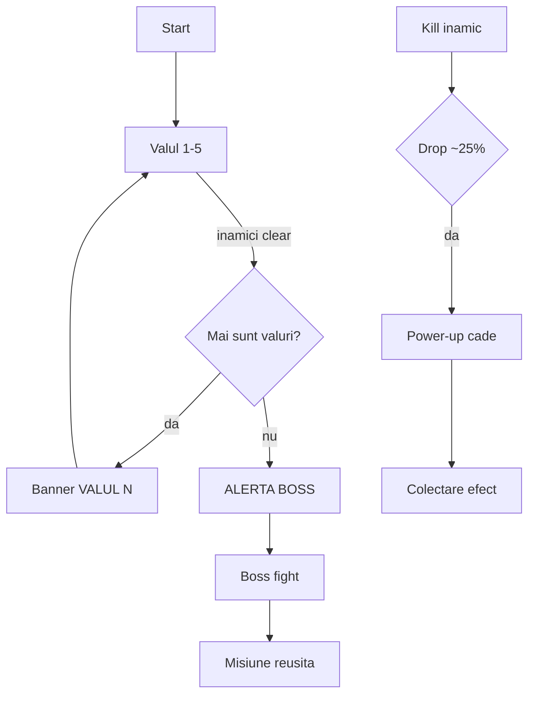

# Plan: Valuri, inamici noi, power-up-uri

## Context
Jocul e un singur nivel în [`game.js`](game.js): flotă de 12 inamici (`kind` 0/1) → alertă → boss. HUD-ul din [`index.html`](index.html) arată scor / fază / vieți. Toată logica e în `update()` + desen pe canvas.

## Decizii concrete
- **5 valuri** de flotă, apoi warning + boss (ca acum).
- **2 tipuri noi**: `shooter` (trage în jos) și `kamikaze` (viteză mare, urmărește ușor jucătorul).
- **4 power-up-uri**: dublu foc, foc rapid, scut (1 hit), viață (+1, max 5).
- Fără sunet, fără alegere de navă, fără high score în acest pas.

## 1. Sistem de valuri
În [`game.js`](game.js), înlocuiește `FLEET_COUNT` + faza unică `fleet` cu:
- `wave` (1..5), `enemiesLeft`, `spawnTimer`, stare scurtă `waveBreak` (~1.5s) între valuri
- tabel `WAVES` cu per val: număr inamici, interval spawn, multiplicator viteză, greutăți pe tipuri (`scout`, `tank`, `shooter`, `kamikaze`)
- Valul 1: mai ales scout; valurile 3–5 introduc shooter/kamikaze; viteza crește ușor
- Când `enemiesLeft === 0` și `enemies.length === 0`: dacă `wave < 5` → `waveBreak` → `wave++`; altfel → `warning` → boss (logica existentă)
- HUD: înlocuiește FAZĂ cu **VALUL** (`#wave`); pe warning/boss afișează ALERTĂ / BOSS ca acum prin același element

Fișiere: [`game.js`](game.js), [`index.html`](index.html) (`id="phase"` → `id="wave"` + label VALUL).

## 2. Tipuri noi de inamici
Extinde `spawnEnemy()` să aleagă tipul după greutățile valului:

| kind | Nume | Comportament |
|------|------|--------------|
| 0 | scout | ca acum: coboară + sine ușor |
| 1 | tank | HP 2–3, mai lent |
| 2 | shooter | coboară mai lent; la cooldown trage 1 glonț în jos (`fireEnemyBullet`) |
| 3 | kamikaze | viteză mare; `x` se apropie de `player.x` cu clamp |

Actualizează loop-ul de mișcare inamici (acum același sine pentru toți) ca să fie per-kind. Extinde `drawEnemyShip()` cu siluete distincte (shooter: canoane; kamikaze: formă ascuțită/portocalie). Scor: shooter +150, kamikaze +200.

## 3. Power-up-uri
- Array `pickups[]`; la kill, ~25% șansă (nu pe boss) să spawneze un tip random
- Cad cu viteză constantă; colectare prin `rectsOverlap` cu player
- Stare pe player: `doubleShot`, `rapidFire` (timere ~8s), `shield` (boolean, consumat la hit), `lives` cap 5
- Tragere: dacă `doubleShot` → 2 gloanțe laterale; dacă `rapidFire` → cooldown mai mic (~0.09)
- `hurtPlayer()`: dacă `shield` → consumă scut + burst scurt, fără −1 viață; altfel ca acum
- Desen: diamante/cercuri colorate pe canvas + text scurt pe HUD când un buff e activ (ex. SCUT / x2 / RAPID), în [`index.html`](index.html)/[`style.css`](style.css) sau overlay pe canvas

## 4. Integrare UI / copy
- Overlay start: menționează valuri + power-up-uri; controls rămân WASD + Spațiu
- Banner pe canvas pentru `waveBreak` (similar cu `BOSS INCOMING`)
- `startGame()` resetează wave, pickups, buff-uri

## Ordine implementare
1. Refactor valuri + HUD VALUL (fără tipuri noi încă)
2. Shooter + kamikaze (spawn weights pe valuri + draw/update)
3. Pickups + efecte + feedback vizual
4. Tunare rapidă: densitate spawn, drop rate, dificultate val 5 vs boss

## Fișiere atinse
- [`game.js`](game.js) — aproape toată logica
- [`index.html`](index.html) — HUD wave + status buff (opțional)
- [`style.css`](style.css) — doar dacă status buff e în DOM
